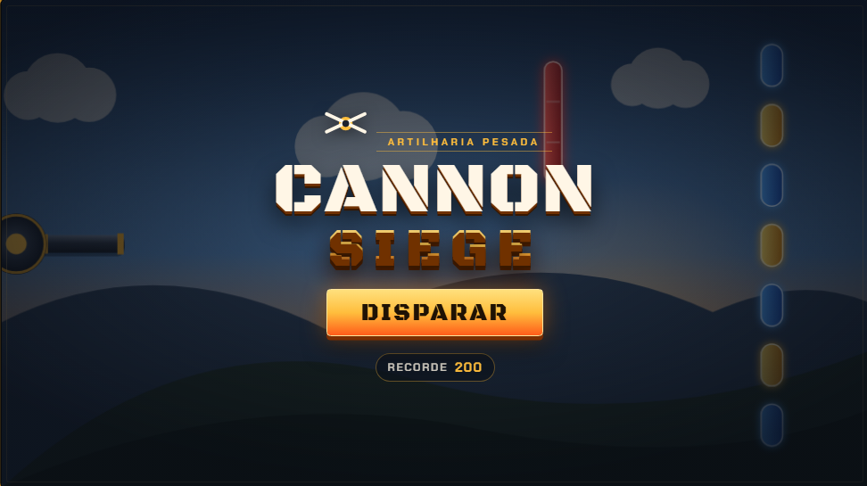
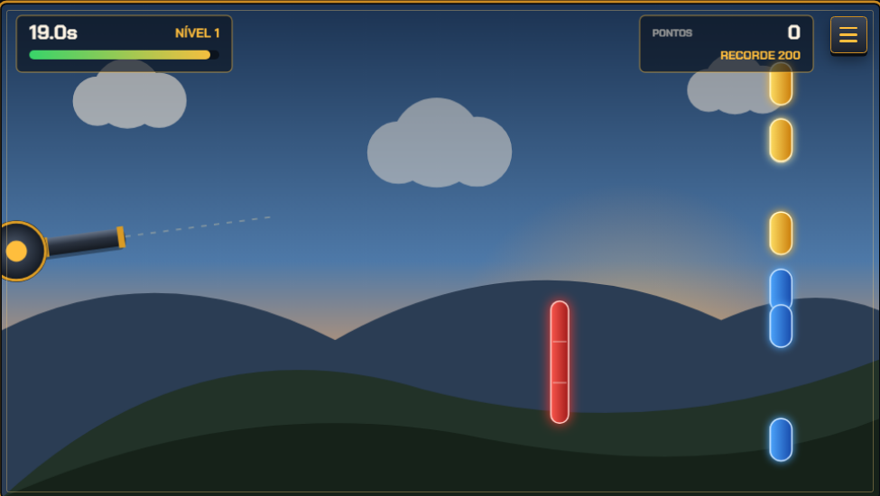
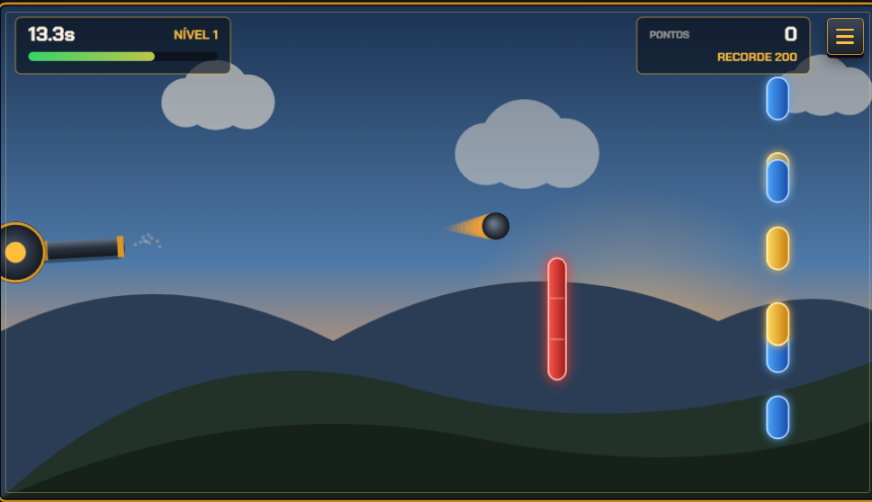
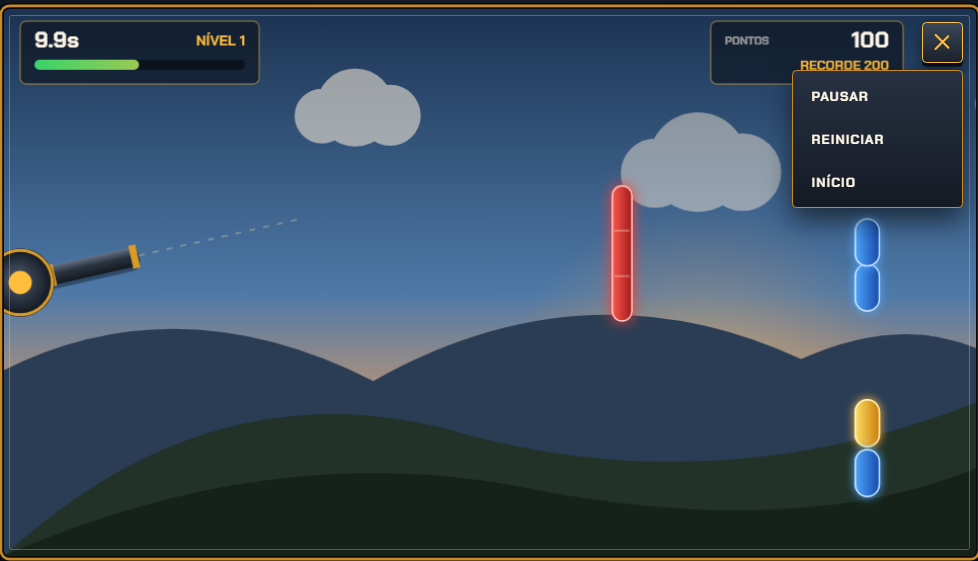
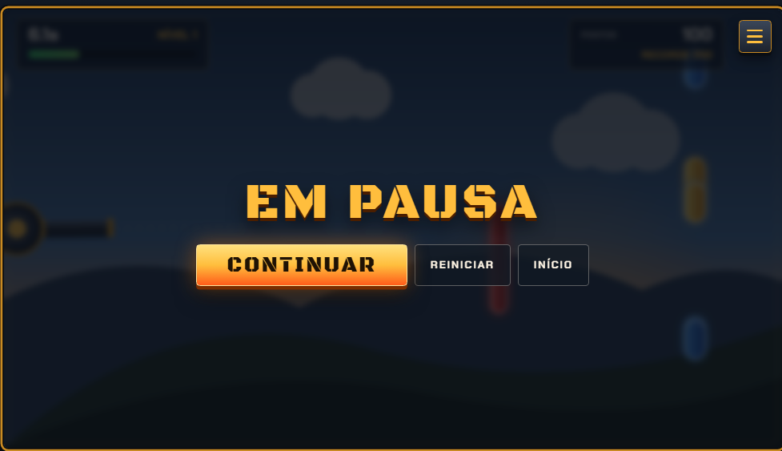

# Cannon Game (Joguinho)

Jogo de canhão para Android desenvolvido na disciplina de **Programação III** (UEMG), baseado no **Capítulo 6 – Cannon Game App** do livro *Android 6 for Programmers: An App-Driven Approach* (3ª edição).

## Integrantes

- Gustavo Amaral Silva
- Maria Olivia Cassucci

## Objetivo

Aplicar, de forma colaborativa, os conceitos fundamentais de programação mobile em Android:

- Animação quadro a quadro (frame-by-frame manual)
- Manipulação gráfica com **Canvas** e **Paint**
- Execução de sons com **SoundPool**
- Controle de **threads** e game loop
- Uso de **SurfaceView** e **SurfaceHolder**
- Modo imersivo / tela cheia
- Interatividade por toque e atualização responsiva da interface

## Como executar

### Requisitos

- [Android Studio](https://developer.android.com/studio) (versão recente)
- JDK 11 ou superior (o Gradle do projeto usa toolchain automática)
- Emulador ou aparelho com **Android 7.0 (API 24)** ou superior

### Passos

1. Clone o repositório:
   ```bash
   git clone https://github.com/gustavoamaralsv/Joguinho.git
   ```
2. Abra a pasta do projeto no Android Studio.
3. Aguarde o sync do Gradle.
4. Selecione um emulador/dispositivo e clique em **Run** (▶).

O app inicia em **orientação landscape** (paisagem), como no livro.

## Como jogar

1. Toque (ou arraste) na tela para **mirar** o canhão e **disparar**.
2. Acerte os **7 alvos** antes que o tempo acabe.
3. Cada alvo destruído concede **+3 s** e pontos.
4. Acertar o **bloqueador vermelho** faz a bala ricochetear e remove **2 s**.
5. Ao limpar todos os alvos, o jogo avança de **nível** (mais rápido) com bônus de tempo.
6. Quando o tempo zera, o diálogo de fim de jogo mostra a pontuação e permite jogar novamente.

## Funcionalidades implementadas

| Tópico do Cap. 6 | Onde está no código |
| --- | --- |
| `SurfaceView` + `SurfaceHolder.Callback` | [`CannonView.kt`](app/src/main/java/com/example/joguinho/game/CannonView.kt) |
| Game loop em thread própria | [`GameThread.kt`](app/src/main/java/com/example/joguinho/game/GameThread.kt) |
| Desenho com Canvas/Paint | classes em [`model/`](app/src/main/java/com/example/joguinho/model/) |
| Eventos de toque | `CannonView.onTouchEvent` |
| Sons (SoundPool) | [`SoundManager.kt`](app/src/main/java/com/example/joguinho/audio/SoundManager.kt) |
| Modo imersivo / tela cheia | [`MainActivity.kt`](app/src/main/java/com/example/joguinho/MainActivity.kt) + tema |
| Diálogo de resultados | [`GameOverDialogFragment.kt`](app/src/main/java/com/example/joguinho/ui/GameOverDialogFragment.kt) |
| Colisão círculo × retângulo | [`Collision.kt`](app/src/main/java/com/example/joguinho/game/Collision.kt) |

### Extras (bônus)

- Níveis infinitos com dificuldade crescente
- Sistema de pontuação e **recorde** persistente (`SharedPreferences`)
- Partículas de explosão e rastro da bala
- Cenário com céu em gradiente, nuvens e colinas
- Barra de tempo no HUD
- Sons novos (`blocker_hit`, `cannon_fire`, `target_hit`, `level_up`, `game_over`)
- Strings em português e inglês (`values` / `values-en`)
- Testes unitários de colisão e regras do jogo

## Estrutura do projeto

```
Joguinho/
├── README.md
├── docs/screenshots/          # prints ou GIF (opcional)
├── tools/generate_sounds.py   # gera game_over.wav
└── app/src/main/
    ├── java/com/example/joguinho/
    │   ├── MainActivity.kt
    │   ├── audio/             # SoundManager
    │   ├── data/              # HighScoreRepository
    │   ├── game/              # CannonView, GameThread, regras
    │   ├── model/             # Cannon, Cannonball, Target, Blocker…
    │   └── ui/                # GameOverDialogFragment
    └── res/
        ├── layout/
        ├── raw/               # efeitos .wav
        ├── values/            # strings (pt-BR), colors, themes
        └── values-en/         # strings em inglês
```

## Screenshots

<p align="center">
  
  <br />
  <em>Tela inicial</em>
</p>

<p align="center">
  
  <br />
  <em>Partida — nível 1, mirando os alvos</em>
</p>

<p align="center">
  
  <br />
  <em>Disparo com rastro da bala</em>
</p>

<p align="center">
  
  <br />
  <em>Menu (pausar / reiniciar / início)</em>
</p>

<p align="center">
  
  <br />
  <em>Tela de pausa</em>
</p>

## Testes

No Android Studio: **Run → Run 'Tests in app'**, ou via terminal (com SDK configurado):

```bash
./gradlew test
```

## Licença / uso acadêmico

Trabalho acadêmico da disciplina de Programação III. Código desenvolvido pelo grupo com base nas orientações do Capítulo 6 do livro citado.
